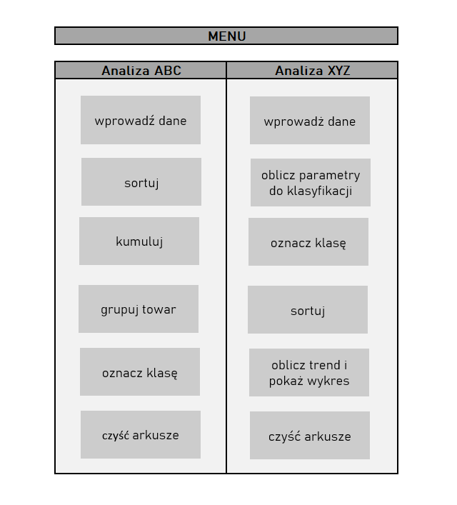
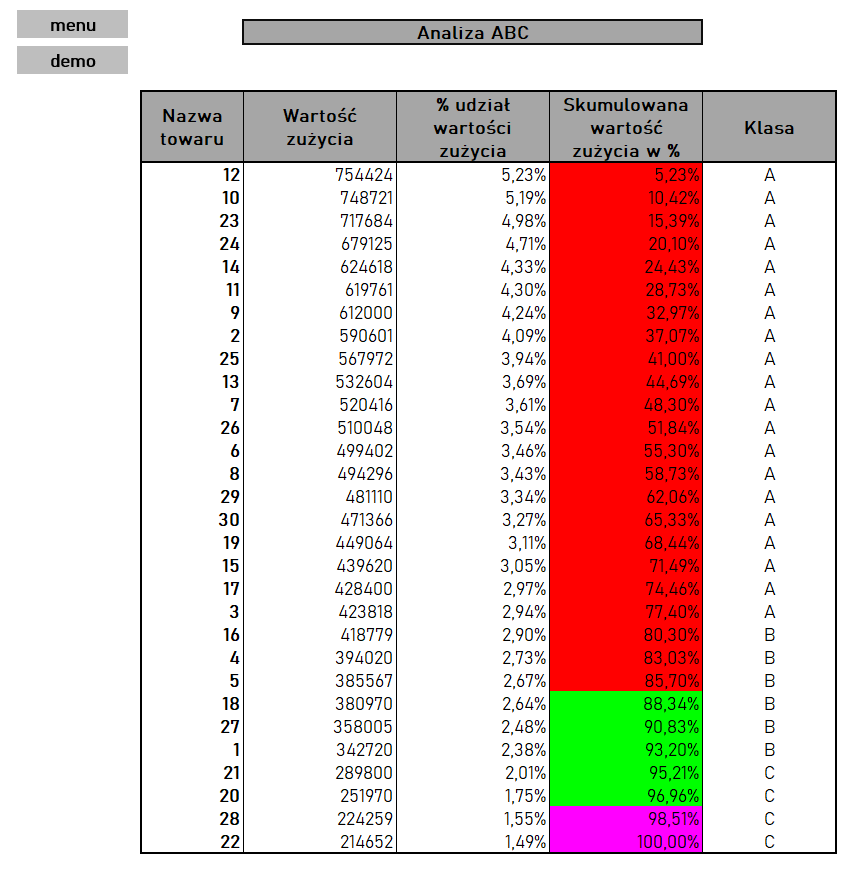
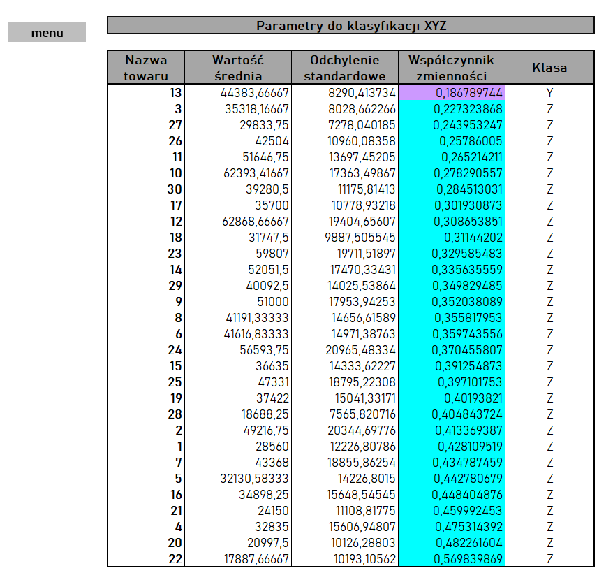
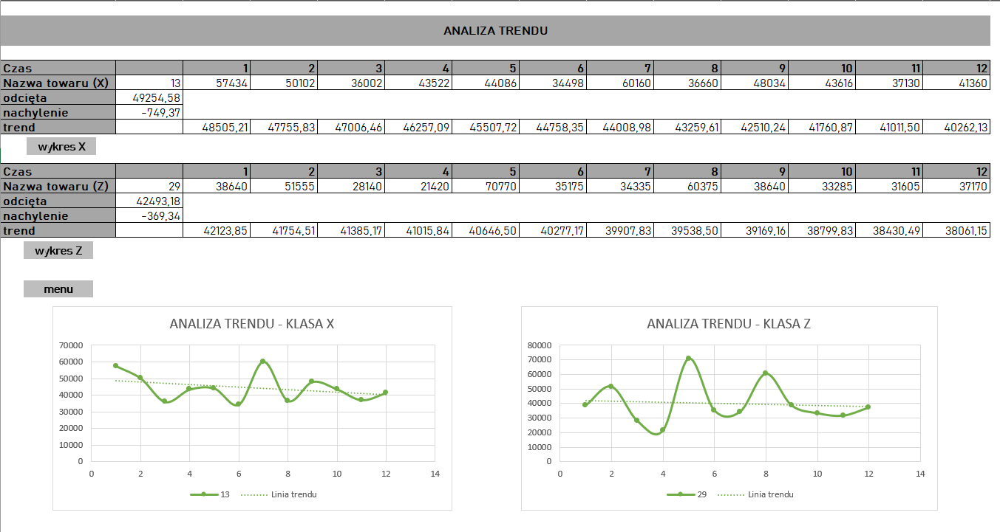
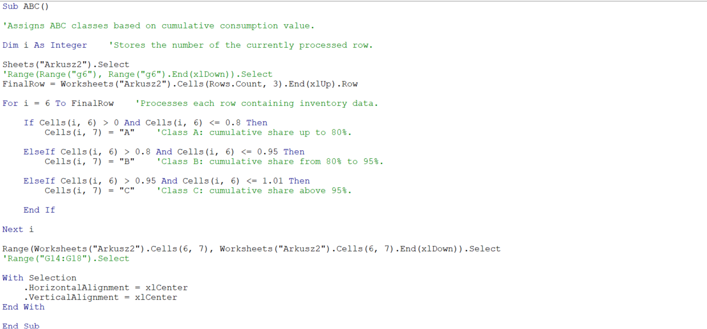

# ABC/XYZ Inventory Analysis in Excel VBA

## Project Overview

This project presents an Excel-based inventory analysis tool combining **ABC and XYZ classification methods** with **VBA automation**.

The workbook supports inventory analysis by:

- classifying items according to their contribution to total consumption value,
- evaluating demand variability,
- assigning ABC and XYZ classes,
- analyzing consumption trends,
- automating selected operations using VBA macros.

> **Note:** This project was originally developed as part of an academic Excel and VBA assignment and was later refined for portfolio presentation.

## Business Purpose

ABC/XYZ analysis supports inventory management by combining two perspectives: the **value of inventory consumption** and the **variability of demand**.

The analysis helps answer questions such as:

- Which inventory items account for the largest share of total consumption value?
- Which items show relatively stable or highly variable consumption?
- Which products may require closer inventory monitoring?
- How do consumption patterns differ between inventory categories?

### How to Interpret the Classification

In the **ABC analysis**, products are classified according to their contribution to total consumption value:

- **Class A** – items with the highest contribution to total consumption value,
- **Class B** – items with a moderate contribution,
- **Class C** – items with the lowest contribution.

In the **XYZ analysis**, products are classified according to the variability of their consumption:

- **Class X** – relatively stable consumption,
- **Class Y** – moderate variability,
- **Class Z** – higher variability.

Combining both approaches provides a broader view of inventory by considering not only its value, but also the stability of consumption patterns.

> **Data note:** The workbook uses randomly generated demonstration data. As a result, classifications and numerical results may change each time the analysis is run. The project therefore focuses on demonstrating the analytical workflow and VBA automation rather than presenting conclusions for a fixed real-world dataset.

## Application Interface

The workbook includes a simple menu that provides access to the main stages of the ABC and XYZ analyses.

## ABC Analysis

The ABC analysis classifies inventory items according to their contribution to total consumption value.

The workflow includes:

- calculating consumption value,
- determining each item's percentage share,
- sorting items by consumption value,
- calculating cumulative percentage contribution,
- assigning items to **A, B, or C classes**.

This approach helps identify which inventory items account for the largest share of total consumption value.

## XYZ Analysis

The XYZ analysis evaluates inventory items based on the variability of their consumption over time.

For each item, the workbook calculates:

- average consumption,
- standard deviation,
- coefficient of variation,
- final **X, Y, or Z classification**.

The coefficient of variation is calculated as:

**Coefficient of Variation = Standard Deviation / Average Consumption**

This classification helps distinguish between items with relatively stable consumption and those with higher demand variability.

## Trend Analysis

The workbook also includes trend analysis to visualize differences in consumption patterns between selected X- and Z-class items.

A linear trend is calculated using historical consumption data and presented together with the observed values.

The comparison illustrates the difference between:

- **Class X** – relatively stable consumption,
- **Class Z** – more variable consumption.

## VBA Automation

VBA macros are used to automate selected stages of the analysis and simplify interaction with the workbook.

The automation includes:

- worksheet navigation,
- data processing and sorting,
- calculation support,
- automatic ABC and XYZ classification,
- trend analysis and chart generation.

The example below shows the VBA logic used to automatically assign inventory items to ABC classes based on cumulative consumption value.

## Tools & Skills

- Microsoft Excel
- Visual Basic for Applications (VBA)
- ABC inventory analysis
- XYZ inventory analysis
- Statistical measures
- Coefficient of variation
- Linear trend analysis
- Data visualization
- Workflow automation

 ## Repository Contents

- `ABC_XYZ_Inventory_Analysis.xlsm` – macro-enabled Excel workbook
- `screenshots/` – project interface, analysis results, charts, and VBA code examples

## How to Use

1. Download the `ABC_XYZ_Inventory_Analysis.xlsm` file.
2. Open the workbook in the desktop version of Microsoft Excel.
3. Enable macros when prompted.
4. Use the main menu to navigate between the ABC and XYZ analyses.

> The workbook contains VBA macros and should be opened in the desktop version of Microsoft Excel.
